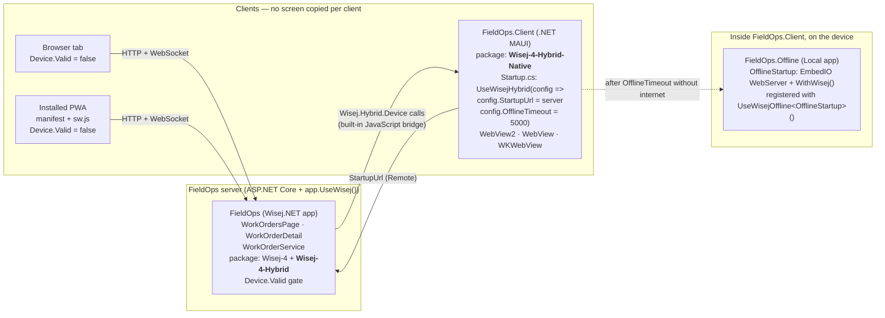

# Architecture — one FieldOps codebase and its clients

| Project | Package | Arrives in | Role |
|---|---|---|---|
| `FieldOps` (web) | `Wisej-4` 4.1.7, `Wisej-4-Hybrid` 4.1.7 | Module 1 (this folder) | All screens, all rules, the `Device` calls. |
| `FieldOps.Client` (MAUI) | `Wisej-4-Hybrid-Native` 4.1.7 | Module 3 | Hosts the app in the platform WebView; implements the device side. |
| `FieldOps.Offline` (Local) | `Wisej-4`, `Wisej-4-Hybrid`, `EmbedIO` | Module 3 | The fallback app on the embedded server, chosen because the decision record picked Remote + Local fallback. |

The joint between them is `Device.Valid`: the web project never branches on which client opened it,
only on whether a Hybrid client is present and what that client can do.
