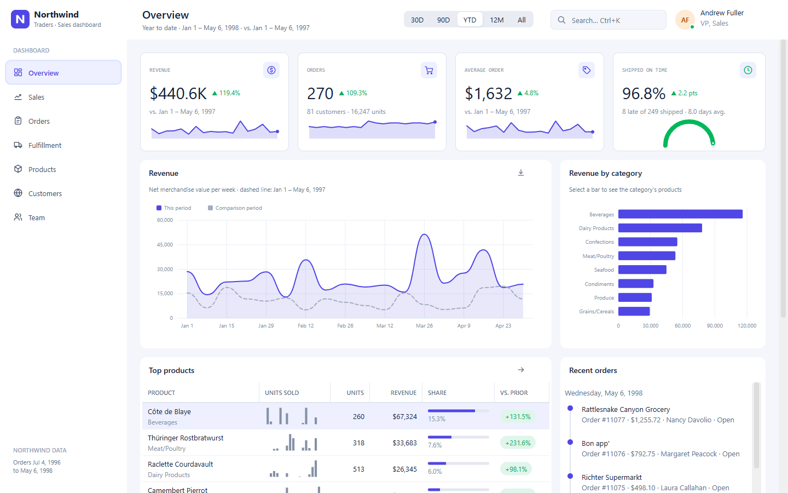

# Wisej.NET 4.2: Build a Northwind Dashboard with AI · reference application

The reference application of the **Wisej.NET 4.2: Build a Northwind Dashboard with AI** course:
**Wisej.NorthwindDashboard**, a sales dashboard over the classic Northwind Traders data, built with
the new Wisej.NET 4.2 controls (`Wisej.Web.NewControls`). Unlike the other
courses, this one has a single application rather than a folder per module: every module of the
course studies and rebuilds a different part of the same finished dashboard.



A sidebar shell (`MainPage`) hosts seven views. The period selector (30D, 90D, YTD, 12M, All) drives
every view that reports on a period, and **Ctrl+K** opens a search palette over pages, periods,
customers, products, people and order numbers.

## Where each course module lives in the application

| Course module | Where to look | New controls it uses |
|---|---|---|
| 1 · Start a Wisej.NET 4.2 Northwind Application | `MainPage.cs`, `SessionStartup.cs`, `Data/DashboardContext.cs` | SegmentedButton, CommandPalette |
| 2 · Build KPI Cards, Sparklines and Meters | `Views/OverviewView.cs`, `Views/FulfillmentView.cs`, `Views/ProductsView.cs` | KpiPanel, Sparkline, MeterBar, RadialGauge |
| 3 · Visualize Northwind Sales with ChartView | `Views/SalesView.cs`, `Views/OverviewView.cs` | ChartView (area, stacked column, bar, waterfall, treemap) |
| 4 · Build Rich Grids, Filters and Order Details | `Views/OrdersView.cs`, `Dialogs/OrderDialog.cs`, `Views/GridRows.cs` | The six new DataGridView column types, ChipGroup, QueryBuilder, EmptyState, ChipLabel, Avatar, Stepper |
| 5 · Coordinate Workflow, Scheduling and Inventory Controls | `Views/FulfillmentView.cs`, `Views/ProductsView.cs`, `Views/OverviewView.cs` | KanbanBoard, SchedulerView, GanttView, Timeline, HeatmapCalendar, ActionCardList |
| 6 · Explore Customers, Teams and Responsive Controls | `Views/CustomersView.cs`, `Views/TeamView.cs`, `ClientProfiles.json`, `Views/CardLayout.cs` | MapView, OrgChart, Avatar, AvatarGroup, responsive profiles |
| 7 · Complete and Test the Wisej.NET 4.2 Dashboard | The whole application | Every control above, checked together |

## Run it

```powershell
cd "Northwind Dashboard with AI Course\Wisej.NorthwindDashboard"
dotnet run -f net10.0 --urls http://localhost:6501
```

Then open http://localhost:6501/Default.html. In Visual Studio, open `Wisej.NorthwindDashboard.slnx`
and press F5.

Requirements: the .NET 10 SDK and a Wisej.NET development or trial license. The project targets
`net10.0-windows` (for the Visual Studio designer) and `net10.0` (for cross-platform hosting).

## The Wisej.NET package

The new controls are not in a released Wisej.NET package yet, so the application restores `Wisej-4`
from the local `Wisej.NorthwindDashboard/packages` folder instead of nuget.org: `NuGet.Config` maps
that one package to the folder and everything else to nuget.org. The package keeps the version
number 4.1.4 but is an unsigned development build that carries the 4.2 controls. Because the
released `Wisej-4` 4.1.4 may already be in your NuGet cache, `NuGet.Config` also gives this sample a
package cache of its own (`.nuget-packages`, ignored by git). Keep the package and `NuGet.Config`
together. See
[`Wisej.NorthwindDashboard/packages/README.md`](Wisej.NorthwindDashboard/packages/README.md).

## What the application shows

| View | What it shows | New controls used |
|---|---|---|
| Overview | Revenue, orders, average order and on-time KPIs; weekly revenue against the comparison period; revenue by category; top products; recent orders; 12-month order heatmap; open orders by warehouse step | KpiPanel, ChartView, DataGridView subtitle/sparkline/meter/chip columns, Timeline, HeatmapCalendar, MeterBar |
| Sales | Category revenue over time with its table view, revenue bridge, top countries, product-mix treemap, revenue per bucket | ChartView (stacked column, waterfall, bar, treemap), DataGridView chip/subtitle columns |
| Orders | Status filters with counts, search, advanced rule builder, drill-down from other views | ChipGroup, QueryBuilder, EmptyState, DataGridView avatar/chip/subtitle/actions columns |
| Fulfillment | Shipper on-time rates and lead time; open orders as a board, a delivery calendar or a lead-time timeline | RadialGauge, KpiPanel, KanbanBoard, SchedulerView, GanttView, SegmentedButton |
| Products | Inventory health, stock status filters, catalog with stock coverage, reorder suggestions | MeterBar segments, ChipLabel, ChipGroup, ActionCardList, DataGridView sparkline/meter/chip/actions columns |
| Customers | Countries shaded by revenue quintile, clustered customer markers, account details, customer list | MapView, Avatar, Sparkline, Timeline, EmptyState, DataGridView avatar/sparkline/chip columns |
| Team | Organization chart, profile with a radar against the team average, top customers, leaderboard | OrgChart, Avatar, AvatarGroup, ChartView (radar), DataGridView avatar/meter/sparkline/chip columns |

The order details dialog (`Dialogs/OrderDialog`) uses a Stepper, ChipLabel and Avatars. Every view
has a `.Designer.cs` file, so the layouts can be opened and edited in the Wisej designer.

## Data and session state

The Northwind data (`Data/northwind.json`, converted from Microsoft's `instnwnd.sql`, MIT license)
and the outlines of the 21 customer countries (`Data/countries.geojson`, from Natural Earth) are
embedded resources, loaded once into an immutable shared `NorthwindDatabase`. The dashboard's
"today" is the last recorded order date, **May 6, 1998**.

The shared data is never modified. Each session has its own `DashboardContext` that records the
warehouse steps on the fulfillment board and the purchase orders placed from the reorder
suggestions; those changes last for the session only.

The application's own
[`README.md`](Wisej.NorthwindDashboard/README.md) covers the data rules, the theme mixin and the
responsive layout (Phone and Tablet client profiles) in detail.
