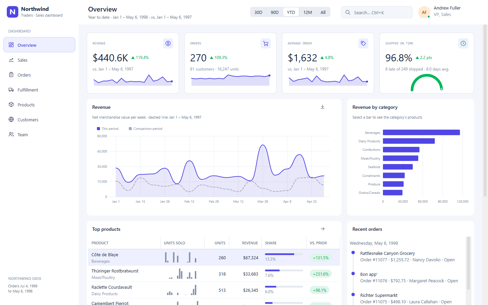

# Northwind Dashboard · From the modules to the original application

What comes after Module 7. The course folder holds two finished dashboards: [`Module 7`](Module%207),
the application the seven modules build, and [`Wisej.NorthwindDashboard`](Wisej.NorthwindDashboard),
the original Northwind application the course was built from. This page shows where each piece of
the module applications lives in the original, what differs between the two, and how to run them
side by side. It is the companion of the course's closing section, which has no quiz and no lab.



## Run it

The module application, on port 6517:

```bash
cd "Northwind Dashboard with AI Course/Module 7/NorthwindDashboard"
dotnet run -f net10.0 --urls http://localhost:6517
```

The original, on port 6501:

```bash
cd "Northwind Dashboard with AI Course/Wisej.NorthwindDashboard"
dotnet run -f net10.0 --urls http://localhost:6501
```

Open <http://localhost:6517> and <http://localhost:6501/Default.html> in two browser windows. Both
need the .NET 10 SDK and a Wisej.NET development or trial license, and both restore the Wisej.NET
package from `Wisej.NorthwindDashboard/packages`, as the [course README](README.md) explains.

## Two applications, one design

Each module studied one part of the original and rebuilt that part in the module application. The
two share more than a design:

- The `Data` folder is the same code in both, file for file. Only the namespace differs.
- `ClientProfiles.json` is identical.
- The views use the same control names and the same event handler names, so a member written in a
  module can be found in the original by searching for its name.

| | Module application (`Module 7`) | Original (`Wisej.NorthwindDashboard`) |
|---|---|---|
| Address | <http://localhost:6517> | <http://localhost:6501/Default.html> |
| Namespace | `NorthwindDashboard` | `Wisej.NorthwindDashboard` |
| Shell | An application bar, a 150-pixel sidebar and a status strip that names the event path of the last interaction | A sidebar and a header that shows the view title and the period with its date range and comparison; no status strip |
| Choosing a view | The area table in `MainPage.Areas.cs`, read by `Navigate` | A `switch` in `MainPage.GetView`, called by `ShowArea` |
| Responsive cards | `MainPage.GetView` asks `CardLayout.For(view)` | `DashboardView.OnResponsiveProfileChanged` creates the `CardLayout` |
| Theme | `Northwind.mixin.theme` and four more mixins, one per group of views, in the application blue | One `Northwind.mixin.theme`, in the indigo palette of the new controls |

## Where each module lives in the original

The members in the last column have the same names in the module applications, except `ShowArea`,
which is `Navigate` there.

| Module | What it builds | Files in the original | Members to search for |
|---|---|---|---|
| [1](Module%201) | The shell, the `SegmentedButton` period selector, the `CommandPalette`, the first `KpiPanel` cards, the customer `MapView`, the session's one `DashboardContext` | [`MainPage.cs`](Wisej.NorthwindDashboard/MainPage.cs), [`SessionStartup.cs`](Wisej.NorthwindDashboard/SessionStartup.cs), [`Data/DashboardContext.cs`](Wisej.NorthwindDashboard/Data/DashboardContext.cs), [`Views/DashboardView.cs`](Wisej.NorthwindDashboard/Views/DashboardView.cs) | `periodSelector_SelectionChanged`, `commandPalette_QueryChanged`, `commandPalette_CommandExecuted`, `ShowArea` |
| [2](Module%202) | `Sparkline` trends and the on-time gauge on the cards, the order-stage `MeterBar`, the shipper `RadialGauge` controls | [`Views/OverviewView.cs`](Wisej.NorthwindDashboard/Views/OverviewView.cs), [`Views/FulfillmentView.cs`](Wisej.NorthwindDashboard/Views/FulfillmentView.cs) | `UpdateKpis`, `stagesMeter`, `UpdateShippers` |
| [3](Module%203) | Sales and its `ChartView` charts; a country bar that opens Customers | [`Views/SalesView.cs`](Wisej.NorthwindDashboard/Views/SalesView.cs), [`Views/OverviewView.cs`](Wisej.NorthwindDashboard/Views/OverviewView.cs) | `UpdateCategoryTrend`, `UpdateBridge`, `UpdateCountries`, `UpdateMix`, `countriesChart_PointClick` |
| [4](Module%204) | Orders: `ChipGroup`, `QueryBuilder`, the new grid columns, `EmptyState`, the order dialog with its `Stepper` | [`Views/OrdersView.cs`](Wisej.NorthwindDashboard/Views/OrdersView.cs), [`Views/GridRows.cs`](Wisej.NorthwindDashboard/Views/GridRows.cs), [`Dialogs/OrderDialog.cs`](Wisej.NorthwindDashboard/Dialogs/OrderDialog.cs) | `statusFilter_SelectionChanged`, `queryBuilder_QueryChanged`, `ApplyFilters`, `colActions_ActionClick`, `OrderDialog.ShowOrder` |
| [5](Module%205) | Fulfillment as `KanbanBoard`, `SchedulerView` and `GanttView`; Products with `ActionCardList`; `Timeline` and `HeatmapCalendar` on Overview | [`Views/FulfillmentView.cs`](Wisej.NorthwindDashboard/Views/FulfillmentView.cs), [`Views/ProductsView.cs`](Wisej.NorthwindDashboard/Views/ProductsView.cs), [`Views/OverviewView.cs`](Wisej.NorthwindDashboard/Views/OverviewView.cs) | `kanbanBoard_CardMoving`, `kanbanBoard_CardMoved`, `UpdateSchedule`, `reorderList_CardCreated`, `ordersHeatmap_CellClick`, `activityTimeline_ItemClick` |
| [6](Module%206) | The Customers explorer, Team with `OrgChart` and `AvatarGroup`, the responsive shell | [`Views/CustomersView.cs`](Wisej.NorthwindDashboard/Views/CustomersView.cs), [`Views/TeamView.cs`](Wisej.NorthwindDashboard/Views/TeamView.cs), [`Views/CardLayout.cs`](Wisej.NorthwindDashboard/Views/CardLayout.cs), [`ClientProfiles.json`](Wisej.NorthwindDashboard/ClientProfiles.json) | `map_MarkerClick`, `map_RegionClick`, `orgChart_NodeClick`, `customersGroup_ItemClick`, `OnResponsiveProfileChanged` |
| [7](Module%207) | The category chart on Overview, products and order numbers in the palette, every view checked together | [`MainPage.cs`](Wisej.NorthwindDashboard/MainPage.cs), [`Views/OverviewView.cs`](Wisej.NorthwindDashboard/Views/OverviewView.cs) | `categoryChart_PointClick`, `Search`, `OrderCommand` |

## What differs between the two

The original shows more on some views than a walkthrough video has room for, and the module
applications have a few pieces the videos needed. Every difference uses a control one of the
modules already configures.

| View | Only in the original | Only in the module application |
|---|---|---|
| Overview | `revenueChart`, the weekly revenue against the comparison period, with a card tool that exports the chart as an image; `productsGrid`, the top products with subtitle, sparkline, meter and chip columns | The status line that reports a refresh from the shared context |
| Sales | `periodGrid`, the revenue of each period bucket as a grid with a chip column; a card tool that exports the category chart | `revenueChart`, the area chart of revenue over time |
| Orders | `colSalesRep`, an avatar column for the sales representative, and `colDelivery`, a subtitle column for the delivery | Product, trend and progress columns; the `scopeChip` and `targetChip` `ChipLabel` controls that show what the list is limited to |
| Fulfillment | `leadTimeKpi`, a `KpiPanel` with the average days to ship | `activityTimeline`, the fulfillment activity of the session |
| Customers | A card tool that clears the country filter | `countryChip`, a closable `ChipLabel` that shows and clears the country filter |
| Products, Team | Nothing: the same controls and the same handlers | Nothing |

## One context in both

What makes seven views one application is the same in both: the session's one `DashboardContext`.
The file is identical, so each chain runs through the same members.

| Interaction | Chain |
|---|---|
| Period | `periodSelector.SelectionChanged` → `DashboardContext.SetPeriod` → `PeriodChanged` → `RefreshView` in every view that uses the period |
| Fulfillment | `KanbanBoard.CardMoved` → `DashboardContext.SetStage` → `OrdersChanged` → `OnOrdersChanged` in every view |
| Purchasing | `ActionCard.ActionClick` → `DashboardContext.PlacePurchaseOrder` → `ProductsChanged` → `OnProductsChanged` in every view |
| Navigation | `DashboardContext.Navigate(area, target)` → `NavigationRequested` → `ShowTarget` in the view the shell opens |

A visible view refreshes at once. A hidden view is marked stale and refreshes when it is shown
again. That rule is in `Views/DashboardView.cs` in both applications.

## What to try

1. Open the same view in both windows. Name each control in the original and the module that
   builds it, then find its handler with the table above.
2. Select **90D** in both and compare the four cards on Overview. Both read `SalesAnalytics`
   through their own `DashboardContext`.
3. On Fulfillment, move an open order to **Shipped** in each application. Then open Overview and
   Orders and find the change in both.
4. Press **Ctrl+K** in both and search for a customer, a product and an order number.
5. Narrow the browser below 1200 pixels and then below 768. Both switch to the Tablet and Phone
   profiles of the same `ClientProfiles.json`.
6. Open the original in a private window. It starts from the Northwind snapshot again, as the
   module application does, because the changes belong to the session.

## Using the original as a reference

For a dashboard of your own, start from what the two applications share: an immutable database
shared by all sessions, one context per session, a base view that refreshes on the context's events,
and a shell that only navigates. Then take each control from the module that builds it and read how
the original configures it. The original's own [`README.md`](Wisej.NorthwindDashboard/README.md)
covers its data rules, theme and responsive layout.
