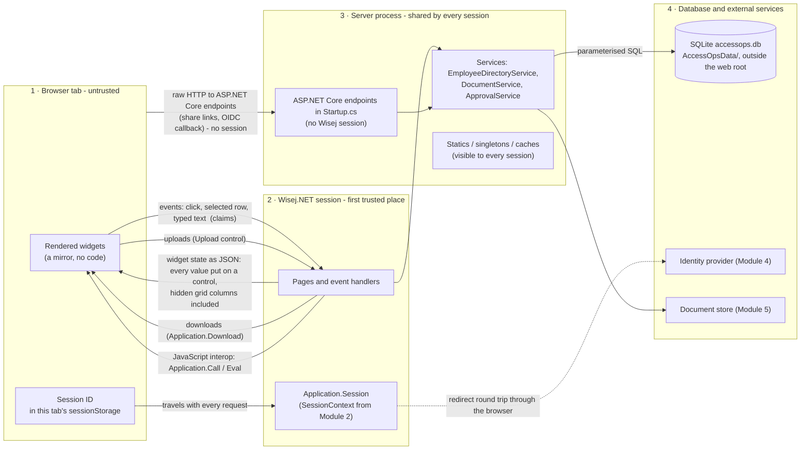

# AccessOps - trust boundary diagram

Four regions, four lines. Everything that crosses a line towards a more trusted region is a
**claim**, and the more trusted side checks it again.

## What crosses each line

| Line | Direction | What crosses | Who checks it |
|---|---|---|---|
| Browser → session | in | Events (which widget, which row, which id), typed text, uploads, the session ID from `sessionStorage` | The page handler forwards; the **service** decides (Module 3) |
| Session → browser | out | Widget state: every value assigned to a control, encoded as text unless `AllowHtml` or `MessageBox.Show` (allowHtml defaults to true); downloads; script run through interop | The **query** decides what exists to be sent (Module 1, verified: hidden grid columns are sent) |
| Browser → process (no session) | in | Raw HTTP to ASP.NET Core endpoints mapped in Startup.cs before `app.UseWisej()` | The endpoint itself: signature, expiry, rate limit (Modules 5, 7) |
| Session → process | both | Calls into shared services; anything stored in a static is visible to every session | Identity comes from `Application.Session`, never a static (Module 2) |
| Process → database | out | SQL commands | Parameters only, minimal rights, append-only audit table (Modules 5, 6) |
| Process ↔ identity provider | both | Authorization code, tokens over the back channel | ID-token validation by the OpenID Connect handler (Module 4) |

## Owners

| Boundary | Owner | Enforcing code (planned) |
|---|---|---|
| Browser ↔ session | Application lead | `LoginService`, `SessionContext` (M2) |
| Session ↔ process | Application lead | `PermissionService`, `Authorize` guard in every service (M3) |
| Process ↔ database | Data owner | Parameterised repositories, `AuditService` (M5, M6) |
| Process ↔ external services | Platform / identity team | OpenID Connect configuration, secrets in the environment (M4, M6) |

## Facts this diagram rests on (verified in this sample)

- The grid in `EmployeesView` holds four values per row in the browser
  (`{"1":"Kwame Osei","2":"Finance","3":"Manager","4":"A. Lindqvist"}`); adding a hidden column
  added its value to every row. See `_template/COOKBOOK.md`.
- `/Default.json`, `/appsettings.json` and `/Data/seed-employees.json` return 404 from the running
  app; `/Default.html` returns 200.
- The session ID is not a cookie: with the default `sessionStorage` setting the browser keeps it in
  the tab's `sessionStorage`, one session per tab.
