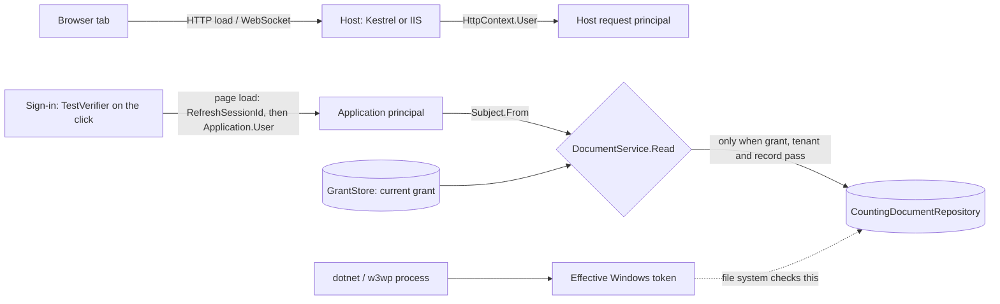

# Three identities, one decision (Module 1 trust note)

An AccessOps request carries three identities. They are separate facts, and none of them is a permission.

| Identity | What it is in AccessOps | Who sets it | What it is NOT |
|---|---|---|---|
| Host request principal | `HttpContext.User` of the HTTP request or WebSocket upgrade. On this Kestrel run: anonymous. Under IIS Windows Authentication (Module 2): a `WindowsIdentity`. | The host (IIS / Kestrel middleware) | Not the AccessOps user: `Application.User` only falls back to it when no session override exists. |
| Application principal | The session override of `Application.User`: a `ClaimsPrincipal` with authentication type `Portal`, claims account ID, tenant, grant ID, roles. | `ApplicationPrincipal.Establish`, on a page load, after a trusted verifier returned the account | Not a permission: `IsAuthenticated` knows nothing about tenants; a role claim is what was true at sign-in. |
| Effective Windows token | The token of the process (`WindowsIdentity.GetCurrent()`), the same for every session and every background job. | The OS account the process runs as (developer account here, the application pool identity on IIS) | Not per user: both browser profiles show the same value. Only scoped impersonation (Module 3) changes it. |

**The decision** is a fourth thing: `DocumentService.Read(subject, tenant, recordId)` reads the grant as
it is *now* (`GrantStore.Find`), refuses a missing, foreign, revoked or expired grant, a missing read
right and a tenant mismatch, and only then calls the repository. Every path (the Open click, the Export
job, any later download) crosses it, so one deny covers them all; `ReadCount` proves the deny happened
before the read.

What the user sees on every deny is one sentence: "Access denied." The reason (`grant`, `role`,
`tenant`, `record`) goes to the audit event with an opaque subject (HMAC of the account ID under a key
in `AccessOpsData/audit-subject.key`), the action, the resource, the decision and a correlation ID —
never a session ID, cookie, token, name or account ID.
