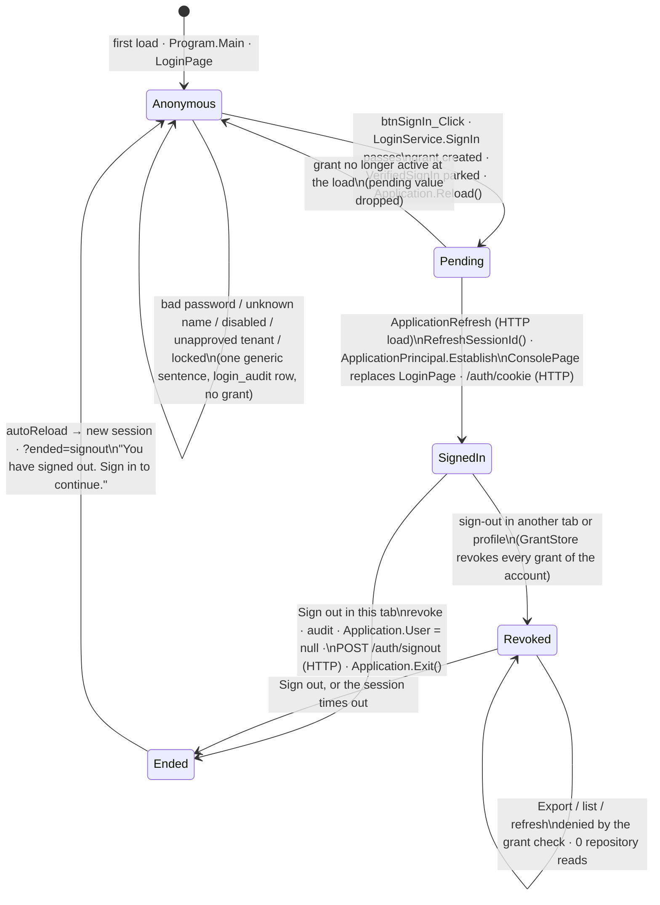

# AccessOps partner route · auth-state transition chart (Module 4)

Five states of one browser tab on the partner route. "Session" is the Wisej.NET session (its ID
lives in the tab's `sessionStorage`); "grant" is the server-side login grant in `GrantStore`;
"host cookie" is the ASP.NET Core ticket `AccessOps.Auth` issued by `/auth/cookie`.

| State | Session principal (`Application.User`) | Grant | Host cookie | What the screen shows |
|---|---|---|---|---|
| Anonymous | none (falls back to the host principal, anonymous on Kestrel) | none | none | LoginPage |
| Pending | none - only `Application.Session["PendingSignIn"]` (a `VerifiedSignIn`: IDs, roles, no password) | created, active | none | LoginPage "Signing in…" until the reload |
| Signed in | `Portal` ClaimsPrincipal: account, tenant, `grant`, role, `amr`, `auth_time` | active | issued, Secure · HttpOnly · SameSite=Strict | ConsolePage |
| Revoked | still set (stale tab) | revoked | rejected by `OnValidatePrincipal` (401 at `/auth/status`) | ConsolePage, but every protected click is denied |
| Ended | session disposed (`Application.Exit()`) | revoked | expired by `/auth/signout` | the tab reloads into Anonymous |

## Test rows (observed 2026-11-09)

**HTTP** marks rows that happen on an ordinary HTTP request beside `app.UseWisej()` (a Wisej
click or WebSocket frame cannot carry them).

| # | Test | HTTP? | Expected | Observed | Where |
|---|---|---|---|---|---|
| 1 | Rotation: sign in as `partner.ana@fabrikam.test` | HTTP (the reload) | session ID changes on the page load; console appears; next click still in the session | `ApplicationRefresh · RefreshSessionId() · rotated=True · isWebSocket=False`, console kept working (Export allowed) | `docs/run-trace.txt`, Chromium browser |
| 2 | Wrong password | - | generic sentence, failures 1 of 5, no grant | "That user name and password combination is not valid." · `outcome=BadCredential` | Chromium browser, trace |
| 3 | Disabled account with its right password | - | the same sentence | same sentence · `outcome=Disabled` | Chromium browser, trace |
| 4 | Five failures, then the right password | - | lockout, same sentence | "failures 5 of 5", sixth attempt refused (`LockedOut`) | Chromium browser, `LoginServiceTests` |
| 5 | Host cookie issued | **HTTP** | Secure, HttpOnly, SameSite=Strict, value redacted | `AccessOps.Auth=(redacted); path=/; secure; samesite=strict; httponly`; `document.cookie` = "" | trace, `HostEndpointTests` |
| 6 | Revoked grant (F05): tab 1 signs out, tab 2 Export | - | "Your sign-in has ended. Sign in again to continue.", 0 reads, no new grant | as expected · `export denied reason=grant … repositoryReads=+0` | Chromium browser (2 tabs), trace |
| 7 | Revoked grant (F05): tab 2 refreshed, Export again | HTTP (the reload) | still denied | the console stays (same session), Export denied, `repositoryReads=+0` | Chromium browser, trace |
| 8 | Host cookie after the sign-out | **HTTP** | `/auth/status` 401 | 401 in tab 2 | Chromium browser (`fetch`), `HostEndpointTests` |
| 9 | Forged post (F11): `POST /auth/signout` without a token, `POST /auth/cookie` with a wrong token | **HTTP** | 400, no state change | 400 and 400; grant still active in the test | Chromium browser (`fetch`), `HostEndpointTests` |
| 10 | Wrong origin (F11): WebSocket upgrade with `Origin: https://evil.example` / none | **HTTP** (the handshake) | 403 before Wisej | 403, 403; own origin 101 | `docs/run-trace.txt`, `HostEndpointTests` |
| 11 | Continuation URL (F11): `/auth/continue?returnUrl=//evil.example` (also `/\evil.example`, `https://evil.example/x`, `/<TAB>/evil.example`) | **HTTP** | redirect to `/` | all landed on `http://localhost:6444/`; `/Default.html?record=17` kept | Chromium browser (`fetch`), `ReturnUrlPolicyTests` |

## Secrets check

- `grep` of the whole server log of the walk for every password typed (`Fabrikam-demo-17`,
  `Fabrikam-demo-old`, `wrong-password`, `bad-1` … `bad-5`) and for the user names: **0 hits**.
  Login rows carry `u-…` / `a-…` HMAC pseudonyms, grants `G-xxxx…`.
- `Application.Session` holds one key on this route, `PendingSignIn`, a `VerifiedSignIn`
  (account ID, tenant, grant ID, roles, display name, method, time) - cleared on the load.
  `LoginServiceTests.The_parked_sign_in_has_no_place_for_a_password_or_a_token` checks that the type
  has no password, secret, token or session property; `No_password_value_reaches_the_login_audit_the_audit_or_a_log_line`
  searches both audit tables and every log line.
- `btnSignIn_Click` clears the password box before the service runs; the value is not stored.
