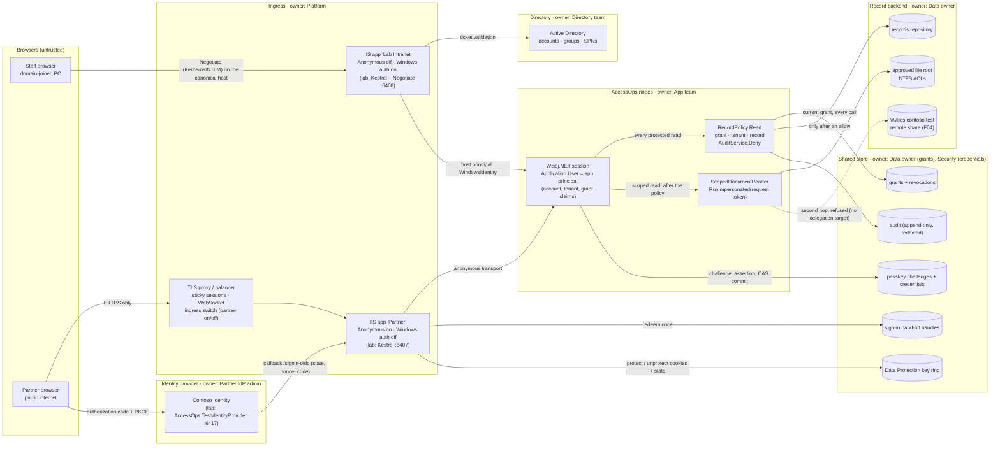

# Trust boundaries · AccessOps release (Module 7)

Two entry points, one policy. Every arrow that crosses a dashed box is a trust boundary; the label
says what crosses it. Owners are roles, not people.

## Identities: origin, trust, expiry, revocation

| Identity | Originates at | Trusted because | Expires | Revoked by (owner) |
|---|---|---|---|---|
| Host principal (`WindowsIdentity` as `Application.User` on the page load) | IIS + the directory (lab: Kestrel Negotiate, local account) | Kerberos ticket or NTLM exchange validated by the host before any Wisej.NET code runs (401 → 200) | the HTTP connection / ticket lifetime; never stored by AccessOps | Directory team: disable the account, remove it from the Reader group |
| App principal + grant (`account`, `tenant`, `grant` claims) | AccessOps, after a verified sign-in on either route | a grant row in the shared store, read on **every** call by `RecordPolicy` | grant: absolute 8 h (`GrantStore.DefaultLifetime`); principal: with the Wisej.NET session | AccessOps admin / Security: `GrantStore.Revoke`; the user: Sign out (all grants of the account) |
| Effective Windows token | the request's Windows token, intranet route only | `WindowsIdentity.RunImpersonated(identity.AccessToken, …)` for one approved file | at the end of the scope, also on an exception (observed: case 4) | the scope itself; the directory for the account |
| Partner external account (issuer + subject) | Contoso Identity | validated ID token: signature, `iss`, `aud`, `exp`, `nonce`; mapped through `external_logins` to an approved tenant | the provider transaction (hand-off handle 2 min) | Partner IdP admin **plus** an AccessOps grant revoke - disabling the user at the provider does not end a grant already issued |
| Passkey credential | the partner's authenticator; enrolled after a verified sign-in | signature over the challenge, exact origin, RP ID hash, owner (user handle), counter, CAS commit | until deleted | the owner (My passkeys → Delete) or Security (credential store) |
| Wisej.NET session | the node that served the first page load | session ID rotated on the sign-in page load (`RefreshSessionId`), client fingerprint | `sessionTimeout` 1200 s; lost with the node | `Application.Exit()` (sign-out) or timeout; a lost node loses its sessions |
| Host auth cookie `AccessOps.Auth` / antiforgery / OIDC correlation + nonce | issued over HTTPS responses by the partner node | protected by the shared Data Protection key ring + application name `AccessOps` | cookie: 8 h, non-sliding; correlation: the provider transaction | grant revoke (`OnValidatePrincipal` rechecks it), key-ring rotation (Platform) |

**Rule of the diagram:** none of the identities above is a permission. The grant row is, and only
`RecordPolicy` reads it - per call, from the shared store - before the repository or a scope runs.
